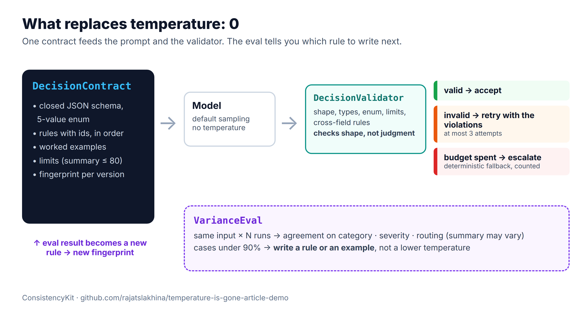
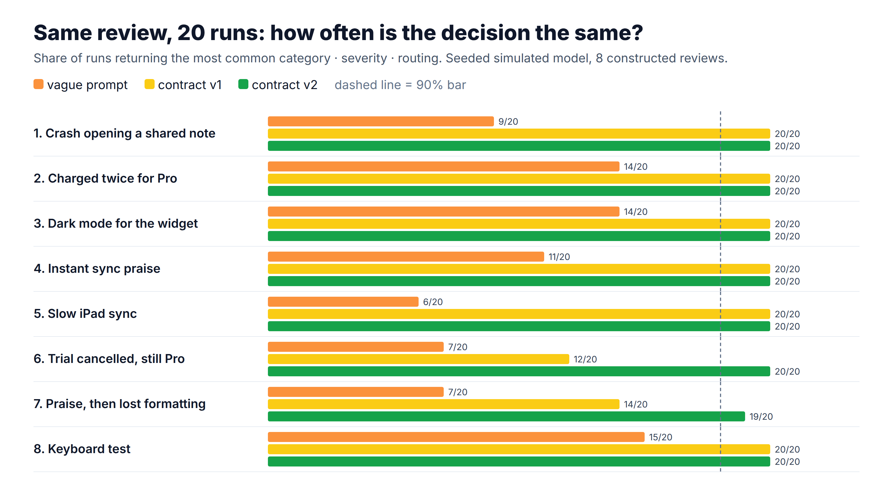
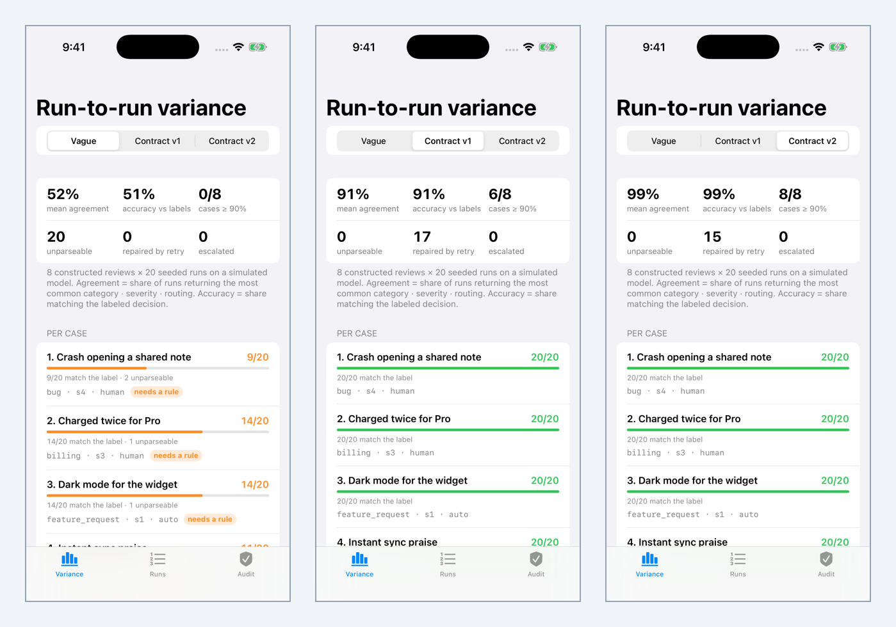

# ConsistencyKit: consistency without `temperature`

Claude API version `2026-10-21` returns a 400 for `temperature`, `top_p` and `top_k`, even at their default values ([migration guide](https://platform.claude.com/docs/en/api/migration-2026-10-21)). If `temperature: 0` was your reliability strategy, this package is what replaces it:

1. **`DecisionContract`**: a closed JSON schema, numbered decision rules, worked examples and limits. The system prompt is rendered from it deterministically and fingerprinted (FNV-1a) per version.
2. **`DecisionValidator`**: deterministic post-validation driven by the same contract: shape, types, enum values, the summary limit and cross-field rules ("severity 4 requires a human").
3. **`ContractPipeline`**: model → validator, with at most 3 repair attempts that send the violations back, then a deterministic escalation.
4. **`VarianceEval`**: runs each input N times and reports agreement on the routing decision (category · severity · needs-human), plus unparseable, repaired and escalated counts.
5. **`LegacyParameterAudit`**: finds and strips the removed sampling parameters in Messages and Message Batch request bodies.

Article: (added after publish)



## The code that matters

```swift
let pipeline = ContractPipeline(contract: .triageV2, client: myClaudeClient)
let outcome = await pipeline.run(reviewText)
// .accepted(decision, attempts:) or .fallback(.escalation(), attempts:, lastViolations:)
```

```swift
let report = await VarianceEval.evaluate(label: "prod", cases: myCases, runs: 20) { item, _ in
    let outcome = await pipeline.run(item.text)
    return .decided(outcome.decision.key, attempts: outcome.attempts, fallback: outcome.isFallback)
}
report.unstableCases(below: 0.9)   // write a rule or an example for each of these
report.fallbackRate                // escalating everything is 100% consistent and useless
```

Wrap your real client by conforming to `ModelClient` (`func complete(_ request: ModelRequest) async throws -> String`). Send no sampling parameters.

## Results from the bundled simulation

`SimulatedModel` is a seeded stand-in so the repo runs without an API key. Its behaviour is an explicit assumption documented in the source (it follows a covering rule 96% of the time, an uncovered case 55% of the time, and sometimes breaks format on a first attempt). **These numbers describe that model, not Claude.**

8 constructed reviews × 20 runs (`VarianceEval.standardComparison()`):

| Setup | Mean agreement | Cases ≥ 90% | Unparseable | Runs repaired by retry | Escalated |
|---|---|---|---|---|---|
| Vague prompt, lenient parser | 51.9% | 0/8 | 20/160 | n/a | n/a |
| Contract `triage-v1` | 91.2% | 6/8 | 0 | 17 | 0 |
| Contract `triage-v2` (+`R-money-first`, `R-mixed`) | 99.4% | 8/8 | 0 | 15 | 0 |

The v1 eval flagged case 6 ("Cancelled my trial but the app still says Pro. Is that a bug?", 12/20) and case 7 (praise followed by a complaint, 14/20). v2 adds a rule for each. That improvement is built into the simulator; the point is the loop, not the number.



## Simulator



The demo app has three tabs: **Variance** (the table above, live), **Runs** (one review, 10 runs, first raw answer → verdict) and **Audit** (a legacy request, its 400 findings and the migrated body).

## How to run it

```bash
git clone https://github.com/rajatslakhina/temperature-is-gone-article-demo.git
cd temperature-is-gone-article-demo
open Demo.xcodeproj   # pick an iPhone Simulator, Build & Run
```

No other setup: the app consumes the package through a local package reference. Library only:

```bash
swift build && swift test
```

## Verification status

- `swift build -Xswiftc -warnings-as-errors` and `swift test` (32 tests, 0 failures): passed on Linux, Swift 6.1.2.
- Simulator run: performed by the `demo-on-simulator` job in `.github/workflows/ci.yml` (build, install, five launches with a process-alive check, screenshots in `Demo/Screenshots/`). **Pending: the job runs on the first push.** Until it has run, `docs/simulator.png` does not exist and the image above will not render.

## License

MIT
